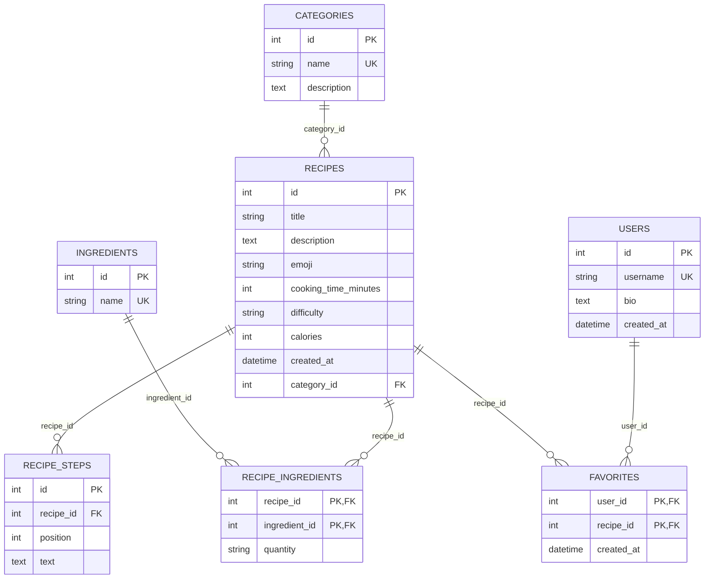

# «Книга рецептов»

Полноценное full-stack приложение (React + TypeScript, FastAPI, PostgreSQL). Ниже — описание по лабораторным работам.

# Лабораторная работа №1 — Frontend

## Назначение приложения
«Книга рецептов» — frontend-приложение для поиска, просмотра и сохранения рецептов. На первом этапе реализован интерфейс и демонстрационные данные без подключения backend и базы данных.

## Пользовательские сценарии
1. Пользователь открывает главную страницу и видит подборку рецептов.
2. Пользователь переходит в каталог рецептов и выбирает категорию.
3. Пользователь открывает карточку рецепта и изучает ингредиенты и шаги приготовления.
4. Пользователь добавляет рецепт в избранное и просматривает сохранённые рецепты.
5. Пользователь открывает профиль с краткой статистикой и настройками интерфейса.

## Основные экраны
- **Главная** — приветственный блок, поиск, категории и популярные рецепты.
- **Рецепты** — каталог с фильтрами по категориям.
- **Рецепт** — подробная карточка выбранного блюда.
- **Избранное** — сохранённые рецепты.
- **Профиль** — информация пользователя и статистика.

## Технологии
- React + TypeScript
- Vite
- React Router
- Material UI (MUI) как библиотека UI-компонентов

## Структура
```text
src/
  components/   переиспользуемые UI-компоненты
  pages/        страницы приложения
  data.ts       демонстрационные данные
  App.tsx       маршрутизация и общая структура
  main.tsx      точка входа
  styles.css    адаптивные стили
```

## Примечание к лабораторной
Выполнены задания 1–5 лабораторной работы №1. Задание 6 намеренно не включалось по условию пользователя.

## Скриншоты
Каталог `docs/screenshots/` содержит материалы по реализованным экранам для сдачи лабораторной.


---

# Лабораторная работа №2 — Backend, API и работа с базой данных

Backend на FastAPI с PostgreSQL через SQLAlchemy 2.0. Код — в каталоге `backend/`.
Frontend пока работает на демонстрационных данных; подключение к API — следующий этап.

## Структура backend
```text
backend/
  app/
    api/routes/   маршруты API (categories, ingredients, recipes, users)
    models/       модели SQLAlchemy (таблицы БД)
    schemas/      схемы валидации Pydantic (запросы и ответы)
    crud/         операции с данными и бизнес-логика
    db/           подключение и сессии, создание таблиц, демо-данные
    core/         конфигурация (.env) и обработка ошибок
    main.py       точка входа FastAPI
  tests/          автотесты API (pytest)
  .env.example    пример настроек без секретов
  requirements.txt
docker-compose.yml   PostgreSQL для разработки
```

## Модель данных
Сущности выведены из экранов frontend (`src/data.ts`): рецепт с категорией, сложностью, калориями, ингредиентами и шагами; избранное и профиль пользователя.



| Таблица | Назначение |
|---|---|
| `categories` | Завтраки, Обеды, Ужины, Десерты (в UI пункт «Все» — это просто отсутствие фильтра) |
| `ingredients` | справочник ингредиентов; создаётся автоматически при сохранении рецепта |
| `recipes` | рецепт; внешний ключ `category_id` |
| `recipe_ingredients` | связь «многие ко многим» рецепт ↔ ингредиент + количество («180 г», «по вкусу») |
| `recipe_steps` | шаги приготовления с порядковым номером |
| `users` | пользователь (экран «Профиль») |
| `favorites` | связь «многие ко многим» пользователь ↔ рецепт (экран «Избранное») |

Правила целостности:
- при удалении рецепта каскадно удаляются его ингредиенты, шаги и записи избранного;
- при удалении пользователя удаляется его избранное;
- категорию с рецептами удалить нельзя (HTTP 409).

## Запуск backend
1. Настройки и PostgreSQL (вариант с Docker, из корня репозитория):
   ```bash
   cp backend/.env.example backend/.env     # задайте свой пароль
   docker compose up -d
   ```
   Если PostgreSQL установлен локально — создайте БД и пользователя с теми же значениями, что в `backend/.env`.
2. Зависимости:
   ```bash
   cd backend
   python -m venv .venv
   source .venv/bin/activate                # Windows: .venv\Scripts\activate
   pip install -r requirements.txt
   ```
3. Создание таблиц и демо-данные (те же рецепты, что в frontend):
   ```bash
   python -m app.db.init_db
   python -m app.db.seed
   ```
4. Запуск:
   ```bash
   uvicorn app.main:app --reload
   ```
   Swagger: http://localhost:8000/docs

## Эндпоинты
| Метод | URL | Описание |
|---|---|---|
| GET, POST | `/categories` | список, создание |
| GET, PATCH, DELETE | `/categories/{id}` | чтение, изменение, удаление |
| GET | `/ingredients` | справочник ингредиентов (`?search=`) |
| GET, POST | `/recipes` | список (`?category_id=&difficulty=&search=&skip=&limit=`), создание |
| GET, PATCH, DELETE | `/recipes/{id}` | чтение, изменение, удаление |
| GET, POST | `/users` | список, создание |
| GET, PATCH, DELETE | `/users/{id}` | профиль (с `favorites_count`), изменение, удаление |
| GET | `/users/{id}/favorites` | избранные рецепты пользователя |
| PUT, DELETE | `/users/{id}/favorites/{recipe_id}` | добавить / убрать из избранного |

Пример создания рецепта:
```json
{
  "title": "Паста с томатами",
  "description": "Простая паста",
  "emoji": "🍝",
  "cooking_time_minutes": 25,
  "difficulty": "Легко",
  "calories": 430,
  "category_id": 3,
  "ingredients": [{"name": "Спагетти", "quantity": "180 г"}],
  "steps": ["Отварите пасту", "Приготовьте соус"]
}
```

## Ошибки и HTTP-статусы
| Код | Когда |
|---|---|
| 201 / 204 | создано / удалено или изменено без тела ответа |
| 400 | указана несуществующая категория, `null` в обязательном поле |
| 404 | запись не найдена |
| 409 | дубликат (категория, пользователь) или удаление категории с рецептами |
| 422 | некорректные данные (пустое название, время ≤ 0, неверная сложность и т.п.) |

Тело ошибки: `{"detail": "понятное сообщение"}`.

## Тесты
```bash
cd backend
pytest
```
Тесты используют SQLite в памяти — PostgreSQL для них не нужен.
