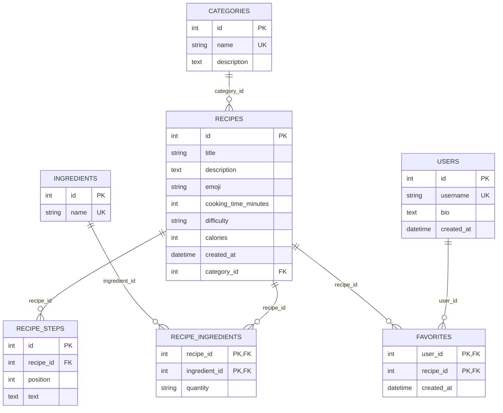

# «Книга рецептов»

Полноценное full-stack приложение (React + TypeScript, FastAPI, PostgreSQL). Ниже — описание по лабораторным работам.

# Лабораторная работа №1 — Frontend

## Назначение приложения
«Книга рецептов» — frontend-приложение для поиска, просмотра и сохранения рецептов. На первом этапе реализован интерфейс и демонстрационные данные без подключения backend и базы данных.

## Пользовательские сценарии
1. Пользователь открывает главную страницу и видит подборку рецептов.
2. Пользователь переходит в каталог рецептов и выбирает категорию.
3. Пользователь открывает карточку рецепта и изучает ингредиенты и шаги приготовления.
4. Пользователь добавляет рецепт в избранное и просматривает сохранённые рецепты.
5. Пользователь открывает профиль с краткой статистикой и настройками интерфейса.

## Основные экраны
- **Главная** — приветственный блок, поиск, категории и популярные рецепты.
- **Рецепты** — каталог с фильтрами по категориям.
- **Рецепт** — подробная карточка выбранного блюда.
- **Избранное** — сохранённые рецепты.
- **Профиль** — информация пользователя и статистика.

## Технологии
- React + TypeScript
- Vite
- React Router
- Material UI (MUI) как библиотека UI-компонентов

## Структура
На этапе лабораторной №1 код был разложен по папкам `components/` и `pages/`. В лабораторной №3 структура переработана по упрощённому Feature-Sliced Design, см. раздел ниже.

## Запуск frontend
Нужен Node.js 20.19 или новее.

```bash
npm install
npm run dev
```
Приложение откроется на http://localhost:5173. Проверка сборки и типов: `npm run build`.

До интеграции с API (лабораторная №5) frontend работает на демонстрационных данных, backend для него не нужен.

## Скриншоты
Скриншоты экранов лежат в `docs/screenshots/` (полный список — в разделе лабораторной №3).

---

# Лабораторная работа №2 — Backend, API и работа с базой данных

Backend на FastAPI с PostgreSQL через SQLAlchemy 2.0. Код — в каталоге `backend/`.
Frontend пока работает на демонстрационных данных; подключение к API — следующий этап.

## Структура backend
```text
backend/
  app/
    api/routes/   маршруты API (categories, ingredients, recipes, users)
    models/       модели SQLAlchemy (таблицы БД)
    schemas/      схемы валидации Pydantic (запросы и ответы)
    crud/         операции с данными и бизнес-логика
    db/           подключение и сессии, создание таблиц, демо-данные
    core/         конфигурация (.env) и обработка ошибок
    main.py       точка входа FastAPI
  tests/          автотесты API (pytest)
  .env.example    пример настроек без секретов
  requirements.txt
docker-compose.yml   PostgreSQL для разработки
```

## Модель данных
Сущности выведены из экранов frontend (`src/data.ts`): рецепт с категорией, сложностью, калориями, ингредиентами и шагами; избранное и профиль пользователя.



| Таблица | Назначение |
|---|---|
| `categories` | Завтраки, Обеды, Ужины, Десерты (в UI пункт «Все» — это просто отсутствие фильтра) |
| `ingredients` | справочник ингредиентов; создаётся автоматически при сохранении рецепта |
| `recipes` | рецепт; внешний ключ `category_id` |
| `recipe_ingredients` | связь «многие ко многим» рецепт ↔ ингредиент + количество («180 г», «по вкусу») |
| `recipe_steps` | шаги приготовления с порядковым номером |
| `users` | пользователь (экран «Профиль») |
| `favorites` | связь «многие ко многим» пользователь ↔ рецепт (экран «Избранное») |

Правила целостности:
- при удалении рецепта каскадно удаляются его ингредиенты, шаги и записи избранного;
- при удалении пользователя удаляется его избранное;
- категорию с рецептами удалить нельзя (HTTP 409).

## Запуск backend
1. Настройки и PostgreSQL (вариант с Docker, из корня репозитория):
   ```bash
   cp backend/.env.example backend/.env     # задайте свой пароль
   docker compose up -d
   ```
   Если PostgreSQL установлен локально — создайте БД и пользователя с теми же значениями, что в `backend/.env`.
2. Зависимости:
   ```bash
   cd backend
   python -m venv .venv
   source .venv/bin/activate                # Windows: .venv\Scripts\activate
   pip install -r requirements.txt
   ```
3. Создание таблиц и демо-данные (те же рецепты, что в frontend):
   ```bash
   python -m app.db.init_db
   python -m app.db.seed
   ```
4. Запуск:
   ```bash
   uvicorn app.main:app --reload
   ```
   Swagger: http://localhost:8000/docs

## Эндпоинты
| Метод | URL | Описание |
|---|---|---|
| GET, POST | `/categories` | список, создание |
| GET, PATCH, DELETE | `/categories/{id}` | чтение, изменение, удаление |
| GET | `/ingredients` | справочник ингредиентов (`?search=`) |
| GET, POST | `/recipes` | список (`?category_id=&difficulty=&search=&skip=&limit=`), создание |
| GET, PATCH, DELETE | `/recipes/{id}` | чтение, изменение, удаление |
| GET, POST | `/users` | список, создание |
| GET, PATCH, DELETE | `/users/{id}` | профиль (с `favorites_count`), изменение, удаление |
| GET | `/users/{id}/favorites` | избранные рецепты пользователя |
| PUT, DELETE | `/users/{id}/favorites/{recipe_id}` | добавить / убрать из избранного |

Пример создания рецепта:
```json
{
  "title": "Паста с томатами",
  "description": "Простая паста",
  "emoji": "🍝",
  "cooking_time_minutes": 25,
  "difficulty": "Легко",
  "calories": 430,
  "category_id": 3,
  "ingredients": [{"name": "Спагетти", "quantity": "180 г"}],
  "steps": ["Отварите пасту", "Приготовьте соус"]
}
```

## Ошибки и HTTP-статусы
| Код | Когда |
|---|---|
| 201 / 204 | создано / удалено или изменено без тела ответа |
| 400 | указана несуществующая категория, `null` в обязательном поле |
| 404 | запись не найдена |
| 409 | дубликат (категория, пользователь) или удаление категории с рецептами |
| 422 | некорректные данные (пустое название, время ≤ 0, неверная сложность и т.п.) |

Тело ошибки: `{"detail": "понятное сообщение"}`.

## Тесты
```bash
cd backend
pytest
```
Тесты используют SQLite в памяти — PostgreSQL для них не нужен.

---

# Лабораторная работа №3 — Архитектура frontend и динамический интерфейс

## Структура frontend (упрощённый Feature-Sliced Design)
Код разделён на слои. Каждый слой может импортировать только слои ниже себя: `app → pages → features → entities → shared`.

```text
src/
  app/        настройка приложения: точка входа App, маршруты, провайдеры, тема, общий Layout, стили
  pages/      страницы: home, recipes, recipe-details, favorites, profile, not-found
  features/   пользовательские действия
    favorites/       добавить в избранное / убрать (состояние + кнопка)
    recipe-filters/  поиск, фильтр по категории и сложности
    recipe-list/     список карточек с состояниями загрузки / ошибки / «нет данных»
    recipe-form/     форма создания и редактирования рецепта с валидацией
    profile-edit/    форма редактирования профиля
  entities/   сущности предметной области
    recipe/    типы, демо-API, контекст данных, карточка рецепта
    category/  список категорий
    user/      профиль и настройки пользователя
  shared/     общие компоненты и утилиты без привязки к предметной области
    ui/        DataState, ConfirmDialog, ToastProvider, анимации диалогов
    lib/       работа с localStorage, форматирование, ошибки
    config/    константы
```

Как избегается дублирование:
- `RecipeList` с состояниями загрузки, ошибки и пустого списка используется на главной, в каталоге и в избранном;
- поиск и фильтры (`useRecipeFilters`, `filterRecipes`) общие для главной и каталога;
- форма рецепта одна и для создания, и для редактирования;
- `DataState` — единое место для трёх состояний экрана;
- карточка рецепта в слое `entities` не знает про избранное: действие передаётся через слот `action`.

## Интерактивные элементы
- **Форма рецепта** (создание на странице «Рецепты», редактирование на странице рецепта): текстовые поля, выпадающие списки, динамические списки ингредиентов и шагов (добавить / удалить строку).
- **Форма профиля**: имя и «о себе».
- **Избранное**: кнопка-сердечко на карточках и на странице рецепта, счётчик в меню, сохранение в `localStorage`.
- **Поиск и фильтры**: поиск с кнопкой очистки, категории, сложность, счётчик найденных рецептов, сброс фильтров.
- **Страница рецепта**: отметка подготовленных ингредиентов, редактирование, удаление с подтверждением.
- **Профиль**: переключатели уведомлений и единиц измерения, редактирование профиля.
- **Уведомления** о результате действий (Snackbar).

## Типизация
Данные описаны типами TypeScript (`Recipe`, `RecipeInput`, `Difficulty`, `Category`, `UserProfile`, `RecipeFormValues`), у компонентов типизированы свойства (`Props`). Допустимые значения категорий и сложности заданы константами с выводом типа (`as const`).

## Клиентская валидация
Правила описаны чистой функцией `validateRecipeForm` (`features/recipe-form/model/validation.ts`), для профиля — `validateProfile`:
- название: 3–80 символов, описание: 10–300 символов;
- категория обязательна;
- время: целое число от 1 до 600 минут, калории: целое число от 0 до 5000;
- минимум один ингредиент и один шаг, поля строк не пустые, ингредиенты не повторяются;
- профиль: имя 2–30 символов, «о себе» не длиннее 100 символов.

Ошибка показывается под полем, когда пользователь покинул поле или нажал «Сохранить». Если сохранение не удалось (сбой «сети»), сообщение выводится в форме, а введённые данные остаются.

## Состояния загрузки, ошибки и отсутствия данных
Данные берутся через `RecipesProvider` из демонстрационного API (`entities/recipe/api/demoApi.ts`). Запросы асинхронные и с задержкой, как настоящие, поэтому на всех экранах с данными есть:
- **загрузка** — скелетоны карточек;
- **ошибка** — сообщение и кнопка «Повторить»;
- **нет данных** — пустое состояние с подсказкой и действием (сбросить фильтры, добавить рецепт, выбрать рецепты).

Чтобы показать состояние ошибки, в профиле есть переключатель «Демо: имитировать сбой сети». В лабораторной №5 `demoApi` заменяется запросами к FastAPI с теми же методами.

## Анимации и переходы
- плавное появление страниц и карточек (с задержкой по порядку);
- диалоги форм и подтверждения выезжают снизу;
- «пульс» сердечка при добавлении в избранное;
- зачёркивание отмеченных ингредиентов, плавное появление строк в форме;
- анимация учитывает системную настройку «уменьшить движение».

## Проверка сценариев
1. Главная → поиск и категории → карточка → страница рецепта → назад.
2. Рецепты → «Добавить рецепт» → отправка пустой формы (видны ошибки) → корректное заполнение → рецепт появился в списке.
3. Страница рецепта → «Редактировать» → сохранить; «Удалить» → подтверждение → переход к списку.
4. Сердечко на карточке → счётчик в меню → страница «Избранное»; снятие отметки; пустое избранное.
5. Профиль → «Редактировать» (ошибки валидации) → сохранить; переключатели настроек.
6. Профиль → «имитировать сбой сети» → «Рецепты» показывает ошибку → отключить сбой → «Повторить».
7. Несуществующий адрес и несуществующий рецепт показывают страницу «не найдено», навигация между экранами работает.

## Скриншоты изменённых экранов
Каталог `docs/screenshots/`:

| Файл | Что показывает |
|---|---|
| `home.png`, `recipes.png`, `detail.png`, `favorites.png`, `profile.png` | основные экраны после изменений |
| `recipe-form.png` | форма создания рецепта |
| `recipe-form-errors.png` | форма с ошибками валидации |
| `recipes-loading.png` | состояние загрузки |
| `recipes-error.png` | состояние ошибки с кнопкой «Повторить» |
| `recipes-empty.png` | «Ничего не найдено» |
| `favorites-empty.png` | пустое избранное |
| `profile-edit.png` | форма редактирования профиля |
